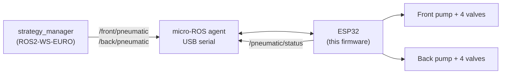

# System_Code_ESP32_pneumatic — suction controller

ESP32 firmware that controls the **suction cups** of AEROBOTIX INSAT's EUROBOT 2026 robot: two vacuum pumps (front and back) and eight solenoid valves, one per suction cup. The Raspberry Pi controls it through **micro-ROS** over USB serial.

It works together with the arm controllers [System_code_ESP32_front](https://github.com/Eurobot-2026-Aerobotix/System_code_ESP32_front) and [System_code_ESP32_back](https://github.com/Eurobot-2026-Aerobotix/System_code_ESP32_back): the arms move down, this board grips, the arms move up.



## ROS interface

| Name | Type | Direction | Meaning |
|---|---|---|---|
| `/front/pneumatic` | `std_msgs/Int32` | subscribe | Front suction cups (see below) |
| `/back/pneumatic` | `std_msgs/Int32` | subscribe | Back suction cups |
| `/pneumatic/status` | `std_msgs/Int64` | publish | Heartbeat for the dashboard |

### Command values

The value is a **4-bit mask, one bit per cup**. The most significant bit (`8`) is cup 0, the least significant (`1`) is cup 3.

- Bit = `1`: the cup's valve opens, which vents the cup and **releases** the element.
- Bit = `0`: the valve stays closed and the cup **holds** by suction.
- The pump runs as long as at least one cup is holding, and stops when all four are released.

| Value | Effect |
|---|---|
| `0` | Pump on, all four cups hold |
| `15` (`0b1111`) | All four cups release, pump off |
| `6` (`0b0110`) | Cups 1 and 2 release, cups 0 and 3 keep holding |
| `16` or more (except `20`) | Everything off (pump and valves) |
| `20` | Reboot the ESP32 |

```bash
ros2 topic pub --once /front/pneumatic std_msgs/msg/Int32 "{data: 0}"    # grip
ros2 topic pub --once /front/pneumatic std_msgs/msg/Int32 "{data: 15}"   # release all
```

## Hardware

| Output | Pins (`src/main.cpp`) |
|---|---|
| Front valves (cups 0-3) | 16, 17, 12, 13 |
| Back valves (cups 0-3) | 5, 21, 22, 33 |
| Front pump | 19 |
| Back pump | 18 |

The pins drive the pump and valve power stages (a pin set HIGH switches the output on).

## Build and flash

Requirements: [PlatformIO](https://platformio.org/).

```bash
pio run -t upload
pio device monitor     # 115200 baud
```

The board reconnects to the micro-ROS agent by itself after a disconnection (`AGENT_WAIT → AVAILABLE → CONNECTED → DISCONNECTED` state machine).
